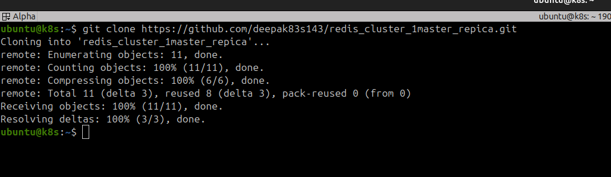
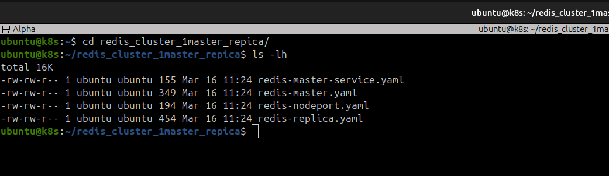
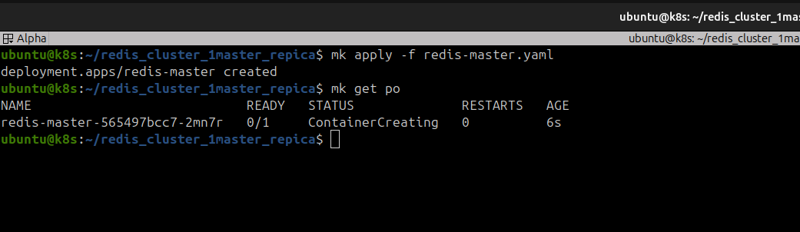
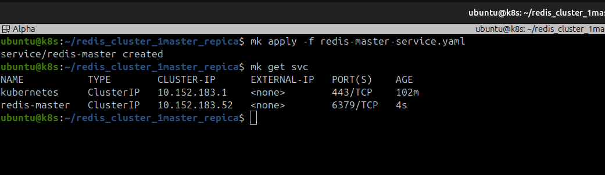
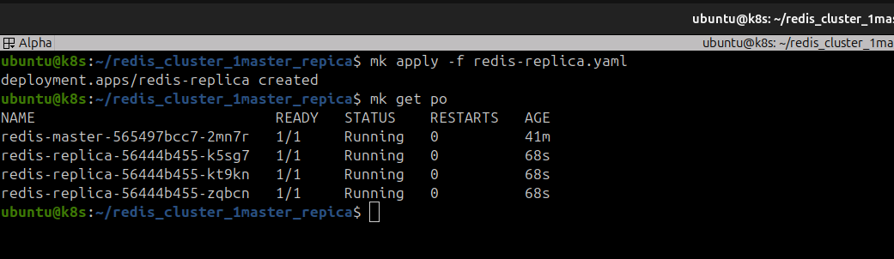
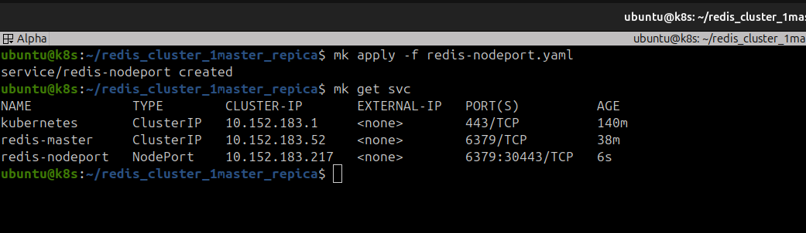

## Redis Cluster in Microk8s.

For the Redis HA we need one **Master** and two **Replica**.

**Step 1: Clone the repository**


```bash
git clone https://github.com/deepak83s143/redis_cluster_1master_repica.git
```



**Step 2: Check the cloned files**

```bash
cd redis_cluster_1master_repica
ls -lh
```



**Step 3: Create Redis master and service**

>✏️**Note**: I use abbribation for ***microk8s kubectl*** as ***mk***

Below is the yaml file for ***redis master***

```yaml
apiVersion: apps/v1
kind: Deployment
metadata:
  name: redis-master
spec:
  replicas: 1
  selector:
    matchLabels:
      app: redis
      role: master
  template:
    metadata:
      labels:
        app: redis
        role: master
    spec:
      containers:
      - name: redis
        image: redis:7
        ports:
        - containerPort: 6379
```

As per our required installation, we need 1 redis master, wo We need to apply redis master yaml without any changes.  

```bash
mk apply -f redis-master.yaml
mk get po    ## to display all pods in default namespace.
```

Wait for 30-40 seconds to successfully pod creation.




Once pod status changed to ***running***. We need to creare ***redis-master-service***.


```bash
mk apply -f redis-master-service.yaml
mk get svc     ##to check created service.
```



**Step 3: Create Redis Replica's**

Once **Redis-Master** created, we need to create **Redis-Replica's**. Change the **redis-replica.yaml** to set the replica (minimum 2 and max as per your k8s cluster)

Make changes in replica's if required.

```yaml
apiVersion: apps/v1
kind: Deployment
metadata:
  name: redis-replica
spec:
  replicas: 3
  selector:
    matchLabels:
      app: redis
      role: replica
  template:
    metadata:
      labels:
        app: redis
        role: replica
    spec:
      containers:
      - name: redis
        image: redis:7
        command:
        - redis-server
        - --replicaof
        - redis-master
        - "6379"
        ports:
        - containerPort: 6379
```


```bash
mk apply -f redis-replica.yaml
mk get po     # to check the created pods.
```




>✏️**Note**: If you need to expose **redis-cluster** using **nodeport**, kindly change the required port in yaml and apply the service.

edit if required **redis-nodeport.yaml**

```yaml
apiVersion: v1
kind: Service
metadata:
  name: redis-nodeport
spec:
  type: NodePort
  selector:
    app: redis
    role: master
  ports:
  - port: 6379
    targetPort: 6379
    nodePort: 30443
```

```bash
mk apply -f redis-nodeport.yaml
mk get svc
```




